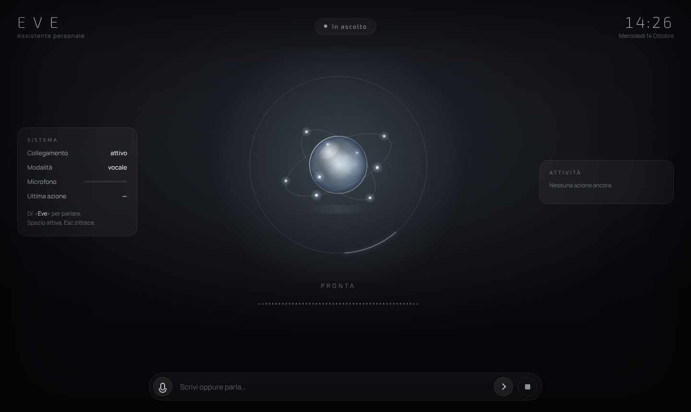
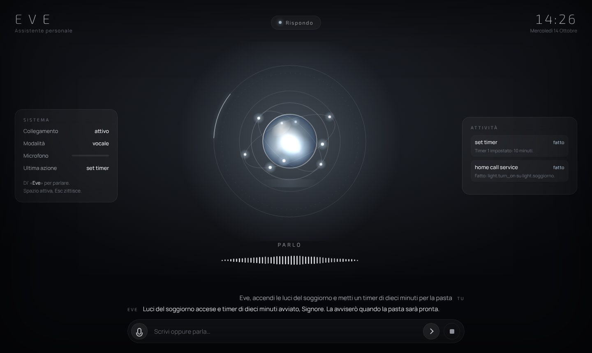

# Eve: assistente vocale sempre in ascolto

Un'assistente personale nello spirito di J.A.R.V.I.S., che gira sul tuo computer. Si chiama Eve e la chiami pronunciando «ivi»:

- **sempre in ascolto**: basta dire «**Eve**» (pronunciato «ivi», senza "hey", senza bottoni, senza chiavi da richiedere) e poi la richiesta;
- **cervello**: Claude (Anthropic) con uso di strumenti, in italiano, con risposte brevi pensate per la voce;
- **agisce davvero**: apre e chiude applicazioni, siti e file, regola il volume, blocca lo schermo, fa screenshot, scrive al posto tuo, imposta timer, ricorda le tue preferenze, cerca sul web, comanda la casa tramite Home Assistant, e (se lo abiliti) esegue comandi di terminale;
- **conferma a voce** prima delle azioni delicate (spegnere, riavviare, comandi di terminale);
- **conversazione naturale**: dopo una risposta resta in ascolto qualche secondo, così puoi continuare senza ripetere la parola;
- **interfaccia elegante**, grafite e argento: una sfera di luce che respira e reagisce alla voce, stato, trascrizione in tempo reale, registro delle azioni;
- **privacy**: parola di attivazione e trascrizione girano in locale; in rete va solo il testo della richiesta, verso l'API di Claude.

| In attesa | Mentre risponde |
|---|---|
|  |  |

> È un progetto separato dalla dashboard Advisor Desk che sta nella radice di questo repository. Vive nella cartella `eve/` e si può spostare in un repository tutto suo senza modifiche.

## Come funziona

```
microfono ──► parola di attivazione ──► registra la frase ──► trascrizione locale (Whisper)
                 (Porcupine)              (rilevamento silenzio)          │
                                                                          ▼
   voce (say / espeak) ◄── risposta ◄── Claude + strumenti (app, sistema, casa, timer, memoria, web)
                                                 │
                                        HUD (browser, WebSocket)
```

1. Il microfono è aperto in continuazione; ogni 80 ms il frame audio passa al rilevatore della parola di attivazione. Nulla viene registrato né inviato finché non dici «Eve».
2. Al riconoscimento suona un breve segnale, l'interfaccia passa a "Ti ascolto" e la frase viene registrata finché fai una pausa.
3. La frase è trascritta in locale con faster-whisper (modello scaricato una volta sola).
4. Il testo va a Claude, che risponde o chiama gli strumenti necessari; i risultati tornano al modello finché la risposta è completa.
5. La risposta viene letta dalla voce di sistema. Per qualche secondo Eve resta in ascolto per il seguito.

## Requisiti

- **Python 3.11 o superiore** (su Mac: `brew install python`).
- **macOS** consigliato (voce `say` integrata, controllo app tramite AppleScript). Linux e Windows funzionano con qualche strumento in meno (vedi tabella).
- Una **chiave API di Anthropic** per Claude: https://console.anthropic.com

## Installazione

Serve **Python 3.11, 3.12 o 3.13** (non 3.15: due librerie audio non hanno ancora i pacchetti per quella versione). Su Mac il Python di sistema è più vecchio: installa Python 3.13 da https://www.python.org/downloads/macos/ ("Latest Python 3.13 Release") oppure con Homebrew (`brew install python@3.13`) e verifica con:

```bash
python3.13 --version
```

Nei comandi che seguono usa `python3.13` al posto di `python3` se sul tuo Mac `python3` è un'altra versione.

Scarica il repository (se non l'hai già fatto) ed entra nella cartella del progetto:

```bash
git clone https://github.com/dennozvice/Denis.git
cd Denis/eve
```

Crea l'ambiente e installa (su Windows il secondo comando è `.venv\Scripts\activate`):

```bash
python3.13 -m venv .venv
source .venv/bin/activate
python -m pip install --upgrade pip
pip install -e ".[dev]"
```

Su **Linux** servono anche le librerie audio e un sintetizzatore, e openWakeWord va installato senza dipendenze:

```bash
sudo apt install libportaudio2 espeak-ng
pip install --no-deps openwakeword
```

Poi la chiave di Claude, sostituendo i puntini con la tua (da https://console.anthropic.com › API Keys). Mettila anche nel tuo `~/.zshrc` per non doverla ripetere a ogni terminale:

```bash
export ANTHROPIC_API_KEY="sk-ant-..."
```

E la configurazione (il file può stare anche in `~/.config/eve/config.toml`):

```bash
cp config.example.toml config.toml
eve setup
```

`eve setup` scarica i modelli e controlla le chiavi.

Al primo `setup` viene scaricato il modello di trascrizione (`small`, circa 500 MB). Con `model = "base"` è più leggero e veloce, con `medium` più preciso.

## Uso

| Comando | Cosa fa |
|---|---|
| `eve run` | avvia tutto: microfono, parola di attivazione, voce e HUD nel browser |
| `eve run --text` | senza microfono: scrivi i comandi (utile per provare) |
| `eve chat --mute` | solo testo, senza voce |
| `eve devices` | elenca i microfoni |
| `eve say "Buongiorno"` | prova la voce |
| `eve listen-test` | prova la parola di attivazione e tara la sensibilità |
| `eve key` | salva la chiave di Claude nel Portachiavi (macOS) o in un file privato |
| `eve app` | crea `Eve.app` per avviarlo dal Dock (macOS) |

Ricorda di attivare l'ambiente in ogni nuovo terminale, con `source .venv/bin/activate` dalla cartella `jarvis`.

### Problemi frequenti

- **`cd: no such file or directory: eve`**: il repository non è stato scaricato, oppure sei nella cartella sbagliata. Esegui il `git clone` qui sopra e poi `cd Denis/eve`.
- **`export: not valid in this context`**: il terminale ha letto un commento come parte del comando. Copia solo la riga `export ...="..."` senza testo dopo.
- **`Directory cannot be installed in editable mode`** oppure `pip 21.x`: il `pip` è troppo vecchio, di solito perché è il Python di sistema. Installa Python 3.13 e ricrea l'ambiente `.venv`.
- **`Package 'eve-assistant' requires a different Python`** oppure errori di compilazione di `ctranslate2`/`onnxruntime`: stai usando Python 3.15. Crea l'ambiente con `python3.13 -m venv .venv`.
- **`fatal: destination path 'Denis' already exists`**: hai già una copia del repository. Entra con `cd ~/Denis`, poi `git fetch origin` e `git checkout claude/financial-advisor-dashboard-lbiycx`.
- **`PortAudio library not found`** su Linux: `sudo apt install libportaudio2`.

Esempi di cose da dire dopo «Eve»:

- «che ore sono?», «come va la batteria?»
- «apri Safari», «chiudi Spotify», «apri la cartella Download», «vai su repubblica.it»
- «volume al trenta», «silenzia», «blocca lo schermo», «fai uno screenshot»
- «timer di dieci minuti per la pasta», «ricordami tra un'ora di chiamare Marco»
- «ricorda che il mio dentista è il dottor Rossi», «cosa sai di me?»
- «accendi le luci del soggiorno», «metti il riscaldamento a ventuno gradi» (con Home Assistant)
- «scrivi: Buongiorno, confermo l'appuntamento di domani» (digita nella finestra attiva)
- «quanto è alto il Monte Bianco?» (ricerca sul web)
- «spegni il computer» → Eve chiede conferma: rispondi «sì» o «no»

Nell'interfaccia: **Spazio** attiva l'ascolto senza dire la parola, **Esc** interrompe la voce, e la casella in basso accetta comandi scritti.

### Usarlo come app (macOS)

Eve può diventare una vera app con icona nel Dock: si avvia con un doppio clic, senza terminale, e l'HUD si apre in una finestra propria.

1. Salva la chiave di Claude nel Portachiavi, così l'app la trova anche se non passa dal terminale (viene chiesta senza mostrarla):

   ```bash
   eve key
   ```

2. Installa il supporto per la finestra e crea l'app:

   ```bash
   pip install -e ".[window]"
   eve app
   ```

   L'app viene creata in `~/Applications/Eve.app` (cartella Applicazioni dentro la tua home). Trascinala nel Dock per tenerla a portata di mano.

3. Al primo avvio macOS chiede il permesso per il microfono: accettalo. Per la scrittura automatica serve anche il permesso di Accessibilità, che macOS propone la prima volta che Eve prova a scrivere.

**Chiudere la finestra non ferma Eve**: resta in sottofondo ad ascoltare, e la finestra ricompare da sola quando dici «Eve» (o «ciao Eve», «ehi Eve»: la parola viene cercata dentro la frase). Per fermarlo davvero: tasto destro sull'icona nel Dock › Esci. Il registro di ciò che succede è in `~/Library/Logs/eve.log`.

Per avere Eve sempre in ascolto dall'accensione del Mac, senza aprirlo a mano:

1. Impostazioni di Sistema › Generali › Elementi login › aggiungi Eve.
2. In `config.toml`, sezione `[ui]`, metti `start_hidden = true` così parte senza mostrare la finestra, e se vuoi `hide_after_seconds = 20` perché la finestra si nasconda da sola dopo venti secondi di inattività.

L'app è un involucro che usa l'ambiente `.venv` del progetto: se sposti o cancelli la cartella del progetto, rilancia `eve app`. Per la stessa finestra senza creare l'app: `eve run --window`.

## Configurazione

Tutte le opzioni sono commentate in `config.example.toml`. Le più utili:

| Sezione | Opzione | Note |
|---|---|---|
| `assistant` | `name`, `user_name` | come si chiama lui e come chiama te |
| `assistant` | `follow_up_seconds` | per quanti secondi resta in ascolto dopo una risposta (0 per disattivare) |
| `wakeword` | `backend`, `threshold` | `whisper` (predefinito) riconosce «Eve» senza chiavi; `porcupine` è più leggero ma serve una chiave Picovoice; `openwakeword` riconosce solo «hey Eve» |
| `audio` | `input_device`, `silence_seconds` | microfono e pausa che chiude la frase |
| `stt` | `model` | `base` veloce, `small` equilibrato, `medium` preciso |
| `tts` | `voice` | su macOS `say -v ?` elenca le voci; «Alice» e «Luca» sono italiane |
| `brain` | `effort`, `web_search`, `notes` | profondità di ragionamento, ricerca web, cose che Eve deve sapere di te |
| `tools` | `allow_shell`, `allow_power`, `typing` | abilita comandi di terminale, spegnimento, scrittura automatica |
| `home_assistant` | `url`, `token` | token "a lunga durata" dal tuo profilo di Home Assistant |

### Come viene riconosciuta la parola «Eve»

Il backend predefinito (`whisper`) trascrive in locale, con il modello `tiny`, una finestra scorrevole di circa due secondi, e solo quando nella stanza c'è voce. «Eve» pronunciato «ivi» può essere trascritto come «ivi», «Ivy», «Evie» o «Eve»: tutte le grafie sono elencate in `aliases` e scatta l'ascolto con una qualsiasi, anche dentro una frase («ciao Eve», «ehi Eve»). L'audio detto subito dopo la parola non va perso. Se vuoi un altro nome, cambia `assistant.name`, `assistant.pronunciation`, `wakeword.model` e `wakeword.aliases`. Costa un po' di CPU mentre qualcuno parla, nulla nel silenzio; se è troppo sensibile alza `threshold` a 0.85, se non ti sente abbassalo a 0.65. `eve listen-test` mostra in tempo reale quando scatta.

Alternative:

- `backend = "porcupine"`: motore dedicato di Picovoice, più leggero e preciso. Serve una AccessKey da https://console.picovoice.ai, che Picovoice concede su richiesta dopo una verifica, e per una parola fuori catalogo come «Eve» un modello `.ppn` creato nella loro console: `model = "/percorso/eve.ppn"`.
- `backend = "openwakeword"`: gratuito e senza registrazione, con un modello `.onnx` personalizzato addestrato con il notebook del progetto openWakeWord: `model = "/percorso/eve.onnx"`.

## Cosa funziona dove

| Funzione | macOS | Linux | Windows |
|---|---|---|---|
| Parola di attivazione, trascrizione, cervello, HUD, timer, memoria, web | ✔ | ✔ | ✔ |
| Voce | `say` | `espeak-ng` | PowerShell |
| Apri/chiudi app, apri file e URL | ✔ | ✔ | ✔ |
| Volume, blocco schermo, screenshot | ✔ | ✔ (pactl, loginctl, gnome-screenshot/scrot) | parziale |
| Scrittura automatica | ✔ (serve il permesso Accessibilità) | con `xdotool` | ✗ |
| Standby, spegnimento, riavvio | ✔ | ✔ | ✔ |
| Home Assistant | ✔ | ✔ | ✔ |

Su macOS, al primo avvio il sistema chiede il permesso per il **microfono** e, per la scrittura automatica, per l'**Accessibilità** (Impostazioni › Privacy e sicurezza).

## Sicurezza e privacy

- Comandi di terminale e spegnimento richiedono sempre una conferma a voce, e i comandi di terminale sono disattivati finché non imposti `allow_shell = true`.
- La chiave API sta nella variabile d'ambiente, nel Portachiavi di macOS oppure in `~/.config/eve/secrets.toml` (leggibile solo dal tuo utente): mai nel codice né nel file di configurazione.
- Audio e trascrizione non lasciano il computer. A Claude vanno il testo delle richieste, le note in `brain.notes` e i fatti memorizzati con «ricorda che…» (file `~/.config/eve/memory.json`, che puoi cancellare quando vuoi).
- L'HUD è raggiungibile solo da questo computer (`127.0.0.1`).

## Sviluppo

```bash
pip install -e ".[dev]"
pytest
```

Struttura:

```
eve/
  assistant.py        orchestratore: stati, ascolto, conferme, conversazione
  cli.py              comandi: run, chat, devices, say, setup, listen-test
  config.py           configurazione TOML
  events.py           bus di eventi verso HUD e console
  audio/              microfono, parola di attivazione, rilevamento fine frase, trascrizione, voce
  brain/              ciclo con Claude e strumenti (apps, system, home, timers, memory)
  ui/                 server WebSocket e HUD (HTML, CSS, JavaScript)
tests/                test senza microfono né rete (client Claude simulato)
```

Per aggiungere uno strumento: una funzione `handler(args) -> str`, registrata con `Tool(nome, descrizione, handler, properties=...)` in uno dei moduli di `brain/tools/`. Gli strumenti che devono chiedere conferma sollevano `NeedsConfirmation` finché non ricevono `_confirmed = True`.
