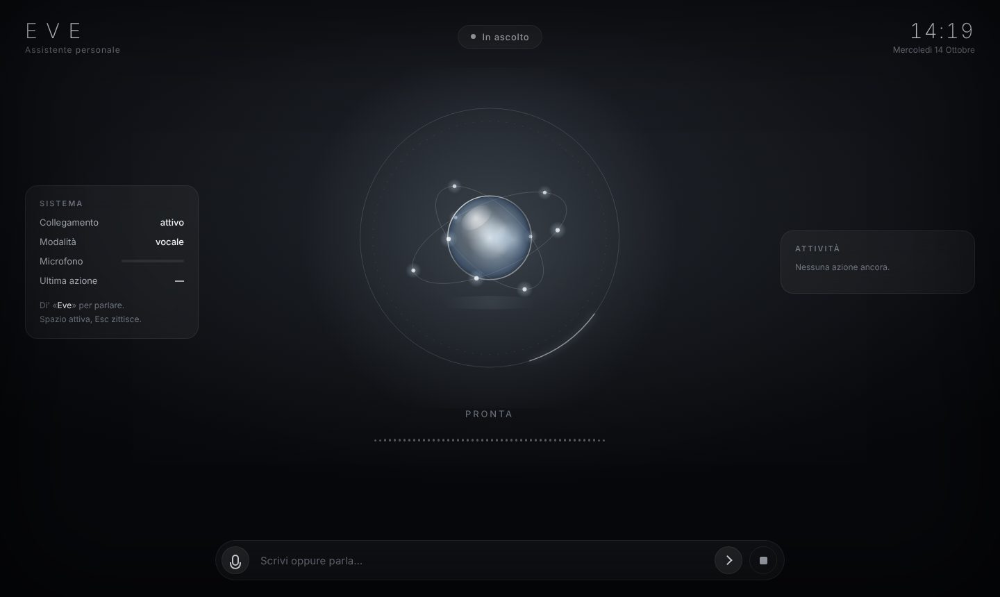

# Jarvis: assistente vocale sempre in ascolto

Un assistente personale in stile J.A.R.V.I.S. che gira sul tuo computer:

- **sempre in ascolto**: basta dire «**Jarvis**» (senza "hey", senza bottoni) e poi la richiesta;
- **cervello**: Claude (Anthropic) con uso di strumenti, in italiano, con risposte brevi pensate per la voce;
- **agisce davvero**: apre e chiude applicazioni, siti e file, regola il volume, blocca lo schermo, fa screenshot, scrive al posto tuo, imposta timer, ricorda le tue preferenze, cerca sul web, comanda la casa tramite Home Assistant, e (se lo abiliti) esegue comandi di terminale;
- **conferma a voce** prima delle azioni delicate (spegnere, riavviare, comandi di terminale);
- **conversazione naturale**: dopo una risposta resta in ascolto qualche secondo, così puoi continuare senza ripetere la parola;
- **HUD olografico** in stile Iron Man: reattore animato che reagisce alla voce, stato, trascrizione in tempo reale, log delle azioni;
- **privacy**: parola di attivazione e trascrizione girano in locale; in rete va solo il testo della richiesta, verso l'API di Claude.

| In attesa | Mentre risponde |
|---|---|
|  |  |

> È un progetto separato dalla dashboard Advisor Desk che sta nella radice di questo repository. Vive nella cartella `jarvis/` e si può spostare in un repository tutto suo senza modifiche.

## Come funziona

```
microfono ──► parola di attivazione ──► registra la frase ──► trascrizione locale (Whisper)
                 (Porcupine)              (rilevamento silenzio)          │
                                                                          ▼
   voce (say / espeak) ◄── risposta ◄── Claude + strumenti (app, sistema, casa, timer, memoria, web)
                                                 │
                                        HUD (browser, WebSocket)
```

1. Il microfono è aperto in continuazione; ogni 80 ms il frame audio passa al rilevatore della parola di attivazione. Nulla viene registrato né inviato finché non dici «Jarvis».
2. Al riconoscimento suona un breve segnale, l'HUD passa a "Ti ascolto" e la frase viene registrata finché fai una pausa.
3. La frase è trascritta in locale con faster-whisper (modello scaricato una volta sola).
4. Il testo va a Claude, che risponde o chiama gli strumenti necessari; i risultati tornano al modello finché la risposta è completa.
5. La risposta viene letta dalla voce di sistema. Per qualche secondo Jarvis resta in ascolto per il seguito.

## Requisiti

- **Python 3.11 o superiore** (su Mac: `brew install python`).
- **macOS** consigliato (voce `say` integrata, controllo app tramite AppleScript). Linux e Windows funzionano con qualche strumento in meno (vedi tabella).
- Una **chiave API di Anthropic** per Claude: https://console.anthropic.com
- Una **AccessKey di Picovoice** (gratuita per uso personale) per la parola «Jarvis»: https://console.picovoice.ai

## Installazione

Serve Python 3.11 o superiore. Su Mac il Python di sistema è più vecchio: installa quello nuovo con Homebrew (`brew install python`) oppure da https://www.python.org/downloads/ e verifica con:

```bash
python3 --version
```

Scarica il repository (se non l'hai già fatto) ed entra nella cartella del progetto:

```bash
git clone https://github.com/dennozvice/Denis.git
cd Denis/jarvis
```

Crea l'ambiente e installa (su Windows il secondo comando è `.venv\Scripts\activate`):

```bash
python3 -m venv .venv
source .venv/bin/activate
python -m pip install --upgrade pip
pip install -e ".[dev]"
```

Su **Linux** servono anche le librerie audio e un sintetizzatore, e openWakeWord va installato senza dipendenze:

```bash
sudo apt install libportaudio2 espeak-ng
pip install --no-deps openwakeword
```

Poi le chiavi, sostituendo i puntini con le tue (da https://console.anthropic.com e https://console.picovoice.ai). Mettile anche nel tuo `~/.zshrc` per non doverle ripetere a ogni terminale:

```bash
export ANTHROPIC_API_KEY="sk-ant-..."
export PICOVOICE_ACCESS_KEY="..."
```

E la configurazione (il file può stare anche in `~/.config/jarvis/config.toml`):

```bash
cp config.example.toml config.toml
jarvis setup
```

`jarvis setup` scarica i modelli e controlla le chiavi.

Al primo `setup` viene scaricato il modello di trascrizione (`small`, circa 500 MB). Con `model = "base"` è più leggero e veloce, con `medium` più preciso.

## Uso

| Comando | Cosa fa |
|---|---|
| `jarvis run` | avvia tutto: microfono, parola di attivazione, voce e HUD nel browser |
| `jarvis run --text` | senza microfono: scrivi i comandi (utile per provare) |
| `jarvis chat --mute` | solo testo, senza voce |
| `jarvis devices` | elenca i microfoni |
| `jarvis say "Buongiorno"` | prova la voce |
| `jarvis listen-test` | prova la parola di attivazione e tara la sensibilità |

Ricorda di attivare l'ambiente in ogni nuovo terminale, con `source .venv/bin/activate` dalla cartella `jarvis`.

### Problemi frequenti

- **`cd: no such file or directory: jarvis`**: il repository non è stato scaricato, oppure sei nella cartella sbagliata. Esegui il `git clone` qui sopra e poi `cd Denis/jarvis`.
- **`export: not valid in this context`**: il terminale ha letto un commento come parte del comando. Copia solo la riga `export ...="..."` senza testo dopo.
- **`Directory cannot be installed in editable mode`** oppure `pip 21.x`: il `pip` è troppo vecchio, di solito perché è il Python di sistema. Installa Python 3.11+ e ricrea l'ambiente `.venv`.
- **`PortAudio library not found`** su Linux: `sudo apt install libportaudio2`.

Esempi di cose da dire dopo «Jarvis»:

- «che ore sono?», «come va la batteria?»
- «apri Safari», «chiudi Spotify», «apri la cartella Download», «vai su repubblica.it»
- «volume al trenta», «silenzia», «blocca lo schermo», «fai uno screenshot»
- «timer di dieci minuti per la pasta», «ricordami tra un'ora di chiamare Marco»
- «ricorda che il mio dentista è il dottor Rossi», «cosa sai di me?»
- «accendi le luci del soggiorno», «metti il riscaldamento a ventuno gradi» (con Home Assistant)
- «scrivi: Buongiorno, confermo l'appuntamento di domani» (digita nella finestra attiva)
- «quanto è alto il Monte Bianco?» (ricerca sul web)
- «spegni il computer» → Jarvis chiede conferma: rispondi «sì» o «no»

Nell'HUD: **Spazio** attiva l'ascolto senza dire la parola, **Esc** interrompe la voce, e la casella in basso accetta comandi scritti.

### Finestra dedicata invece del browser

```bash
pip install -e ".[window]"
```

e in `config.toml` metti `[ui] open = "window"`.

### Avvio automatico all'accesso (macOS)

Crea `~/Library/LaunchAgents/it.jarvis.plist` con il comando `.../.venv/bin/jarvis run --config /percorso/config.toml` e caricalo con `launchctl load`. In alternativa, aggiungi un'app Automator che lancia lo script agli Elementi login.

## Configurazione

Tutte le opzioni sono commentate in `config.example.toml`. Le più utili:

| Sezione | Opzione | Note |
|---|---|---|
| `assistant` | `name`, `user_name` | come si chiama lui e come chiama te |
| `assistant` | `follow_up_seconds` | per quanti secondi resta in ascolto dopo una risposta (0 per disattivare) |
| `wakeword` | `backend`, `threshold` | `porcupine` riconosce «Jarvis»; `openwakeword` è gratuito ma riconosce «hey Jarvis» |
| `audio` | `input_device`, `silence_seconds` | microfono e pausa che chiude la frase |
| `stt` | `model` | `base` veloce, `small` equilibrato, `medium` preciso |
| `tts` | `voice` | su macOS `say -v ?` elenca le voci; «Alice» e «Luca» sono italiane |
| `brain` | `effort`, `web_search`, `notes` | profondità di ragionamento, ricerca web, cose che Jarvis deve sapere di te |
| `tools` | `allow_shell`, `allow_power`, `typing` | abilita comandi di terminale, spegnimento, scrittura automatica |
| `home_assistant` | `url`, `token` | token "a lunga durata" dal tuo profilo di Home Assistant |

### Parola di attivazione senza registrazione

Se non vuoi una chiave Picovoice, usa openWakeWord: `backend = "openwakeword"`, `model = "hey_jarvis"`. In quel caso la parola è «hey Jarvis». Puoi anche addestrare un modello personalizzato per «Jarvis» con il notebook del progetto openWakeWord e indicare il file: `model = "/percorso/jarvis.onnx"`.

## Cosa funziona dove

| Funzione | macOS | Linux | Windows |
|---|---|---|---|
| Parola di attivazione, trascrizione, cervello, HUD, timer, memoria, web | ✔ | ✔ | ✔ |
| Voce | `say` | `espeak-ng` | PowerShell |
| Apri/chiudi app, apri file e URL | ✔ | ✔ | ✔ |
| Volume, blocco schermo, screenshot | ✔ | ✔ (pactl, loginctl, gnome-screenshot/scrot) | parziale |
| Scrittura automatica | ✔ (serve il permesso Accessibilità) | con `xdotool` | ✗ |
| Standby, spegnimento, riavvio | ✔ | ✔ | ✔ |
| Home Assistant | ✔ | ✔ | ✔ |

Su macOS, al primo avvio il sistema chiede il permesso per il **microfono** e, per la scrittura automatica, per l'**Accessibilità** (Impostazioni › Privacy e sicurezza).

## Sicurezza e privacy

- Comandi di terminale e spegnimento richiedono sempre una conferma a voce, e i comandi di terminale sono disattivati finché non imposti `allow_shell = true`.
- Le chiavi API stanno nelle variabili d'ambiente, mai nel codice né nel file di configurazione versionato (`config.toml` è nel `.gitignore`).
- Audio e trascrizione non lasciano il computer. A Claude vanno il testo delle richieste, le note in `brain.notes` e i fatti memorizzati con «ricorda che…» (file `~/.config/jarvis/memory.json`, che puoi cancellare quando vuoi).
- L'HUD è raggiungibile solo da questo computer (`127.0.0.1`).

## Sviluppo

```bash
pip install -e ".[dev]"
pytest
```

Struttura:

```
jarvis/
  assistant.py        orchestratore: stati, ascolto, conferme, conversazione
  cli.py              comandi: run, chat, devices, say, setup, listen-test
  config.py           configurazione TOML
  events.py           bus di eventi verso HUD e console
  audio/              microfono, parola di attivazione, rilevamento fine frase, trascrizione, voce
  brain/              ciclo con Claude e strumenti (apps, system, home, timers, memory)
  ui/                 server WebSocket e HUD (HTML, CSS, JavaScript)
tests/                test senza microfono né rete (client Claude simulato)
```

Per aggiungere uno strumento: una funzione `handler(args) -> str`, registrata con `Tool(nome, descrizione, handler, properties=...)` in uno dei moduli di `brain/tools/`. Gli strumenti che devono chiedere conferma sollevano `NeedsConfirmation` finché non ricevono `_confirmed = True`.
